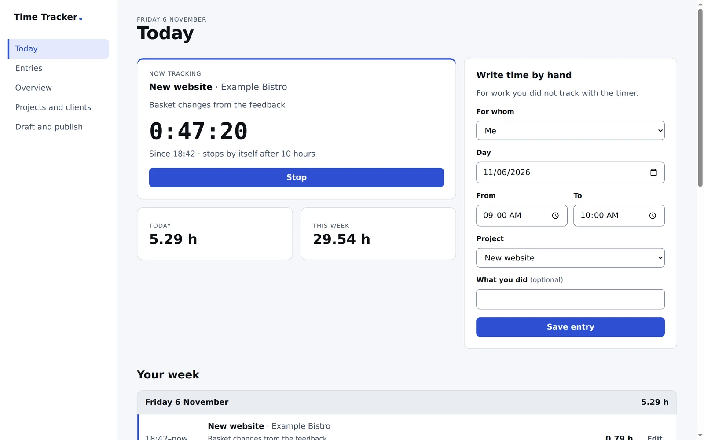

# Time Tracker

Time tracking on projects for a Lazurio Organization (in Czech, *Evidence
času*): timers, time written by hand, projects and clients, an overview of the
week and the month, and CSV exports for invoicing and payroll. Time Tracker is
a Module of the
[Lazurio Module Standard](https://github.com/Lazurio/LazurioPlatform/blob/main/docs/module-standard.md)
and a template of the Lazurio Marketplace, published by LazurioTemplates as
the public upstream `LazurioTemplates/time-tracker` under the MIT license.



- **Timers and time by hand.** A person starts a timer on a project and stops
  it, or writes a day, a start and an end. A forgotten timer ends by itself
  ten hours after its start and is flagged for a correction.
- **Projects and clients.** Projects belong to a client or are the
  Organization's own work, and are invoiced or not. Archived ones keep their
  history and take no new time.
- **The week and the month.** Hours in total and to invoice, per day, project,
  client and person, and the working days nobody recorded (weekends and the
  Czech public holidays left out).
- **Exports.** Every entry, or hours by client, project and person, as CSV
  that Czech or English spreadsheets open as they are.
- **Team entries, each person's own.** An application user sees and changes
  only their own entries; an application admin sees and corrects everyone's,
  keeps projects and clients and publishes the draft
  ([`docs/access.md`](docs/access.md)).
- **Draft & Publish.** Every change is a draft in the Environment; an
  application admin reviews the changed records and publishes them as one
  change to the Organization's data repository.

## Languages

Everything people read is in Czech or in English, never mixed on one screen:
the interface, the server's answers, the review of the draft, the CSV
(separators and decimals included) and the example records. The language is
the instance's (`app/v3/src/instance/settings.ts`, Czech by default); the
adopting agent sets it from the language of the Organization's Lazurio
([`docs/adoption.md`](docs/adoption.md)). Code, comments and documentation
are English. Screenshots: [`docs/screenshots/cs/`](docs/screenshots/cs/) and
[`docs/screenshots/en/`](docs/screenshots/en/).

## How it is built

| | |
| --- | --- |
| App generation | `app/v3`: data in [repository-db](https://github.com/Lazurio/repository-db) |
| Stack profile | [`app-data`](https://github.com/Lazurio/LazurioPlatform/blob/main/docs/stack-profiles.md#app-data), release 2026.11 (`app-data@2026.11`): Bun 1.4.4, TypeScript 7.0.2, Vite 8.3.5, React 19.3.1, Biome 2.6.4, Zod 4.6.7, `@lazurio/repository-db` v3.2.6; exact versions only. `@lazurio/module-kit` is v0.3.0 instead of the profile's v0.2.0, for `appAccess` ([`docs/extending.md`](docs/extending.md)) |
| Born from | `lazurio module create --stack vite-react --data` of LazurioPlatform `main` |
| Data | the Organization's own repository `time-tracker-data`, branch `v3`, checked out as `db/` |
| Shape of the data | Zod schemas in `app/v3/src/domain/`; the JSON Schemas of the data repository are generated from them |
| Who came | `appAccess` of `@lazurio/module-kit`, read on the server for every request |
| Look | the design system [`LazurioTemplates/design-system`](https://github.com/LazurioTemplates/design-system) v1.0.0, merged as the subtree `app/v3/design-system` |

```text
app/v3/src/
  domain/      Zod schemas and pure logic: time, calendar, rules, reports, CSV, access
  data/        the storage port (store.ts), its repository-db and memory implementations,
               the review adapter
  server/      Bun.serve: the HTTP API over the port, appAccess, health, the client
  ui/          React over the HTTP API, the design system's frame and components,
               WebMCP tools
  language/    every text for people, Czech and English
  instance/    the Organization's own settings: name, language, time zone, timer limit
  cli/         schema export and the rules check of the data
app/v3/seed/cs, app/v3/seed/en   the fictional example records, one set per language
app/v3/design-system/            the merged release of the design system, never edited here
app/v3/tests/store-contract.ts   the shared test suite every store implementation passes
templates/data-repo/             the data repository an adopting Organization starts from
.agents/skills/, .claude/skills/ the procedures for agents (the same files)
```

The server never runs Git on the data and never reads a record file by a path
it built: every read and write goes through the storage port, which in `v3`
is repository-db's sync host. Generation `v4` (Dolt) replaces only that port
implementation ([`docs/extending.md`](docs/extending.md)).

## Run it

Lazurio starts the App from its Module manifest: `lazurio module start
<Organization>/time-tracker`. To work on it in a worktree:

```bash
cd app/v3
bun install --frozen-lockfile
bun run check          # typecheck, Biome, tests, data validation, generated schemas
LAZURIO_RUNTIME_LISTENER_APP_HOST=127.0.0.1 LAZURIO_RUNTIME_LISTENER_APP_PORT=<free port> bun run dev
```

`bun run dev` serves the data checkout `db/` at the Module root. Without one,
the App runs and says that the data is not available yet. `bun run dev:demo`
serves the fictional example instead, moved to the current weeks and held in
memory, as a fictional application admin (`--as user` for an application
user, `--lang en` for English); nothing is read from or written to a
repository. The screenshots come from it.

| Script | Does |
| --- | --- |
| `check` | the one gate: `typecheck`, `lint`, `test`, `validate:data`, `schema:check` |
| `validate:data` | the example records of `seed/cs` and `seed/en` against the schemas and the rules across records |
| `validate:db` | the data checkout `db/` (draft included) the same way, before a publication |
| `schema:export` | regenerates `templates/data-repo/schemas/*.schema.json` from the Zod schemas |
| `build` | the client build of the built version (`dist/`) |

## For agents

`AGENTS.md` holds the rules. The procedures live as skills in
`.agents/skills/` (and the same files in `.claude/skills/`): writing a
person's time from their description, preparing a timesheet for invoicing and
finding the missing days. In the Environment browser the App also offers its
main actions as WebMCP tools (`find_time_entries`, `start_timer`,
`add_time_entry`, `get_time_report` and more); none of them publishes or
deletes.

## Adopt it

The Marketplace in Lazurio hands an agent a brief; the agent follows
[`docs/adoption.md`](docs/adoption.md): it checks rights and name collisions,
creates a private Module with `lazurio module create --data`, merges the
released commit so it stays an ancestor, prepares the data repository and
opens pull requests. Nothing is merged or activated without the person's
instruction.

## Documents

- [`AGENTS.md`](AGENTS.md): rules for agents working on this repository and its data
- [`docs/adoption.md`](docs/adoption.md): taking the template into an Organization
- [`docs/extending.md`](docs/extending.md): changes within the generation, the move to
  `v4`, template and design system updates, stack profile releases
- [`docs/data.md`](docs/data.md): the records, time and calendar, the exports, the data repository
- [`docs/access.md`](docs/access.md): who may see and change what
- [`CHANGELOG.md`](CHANGELOG.md), [`SECURITY.md`](SECURITY.md), [`CONTRIBUTING.md`](CONTRIBUTING.md), [`NOTICE.md`](NOTICE.md)

## License

MIT, see [`LICENSE`](LICENSE).
